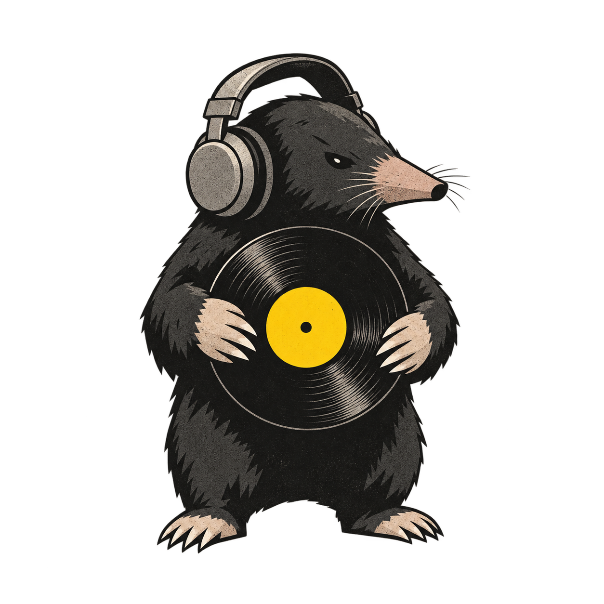
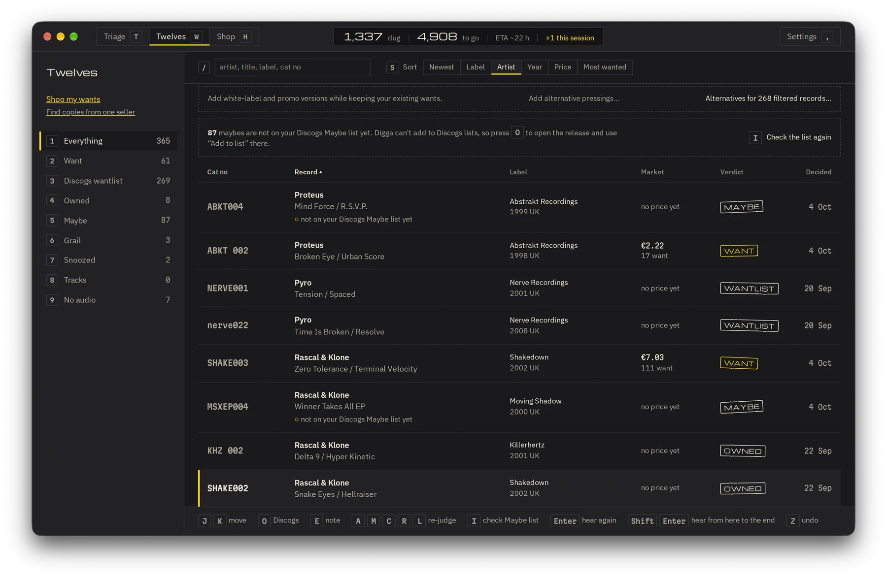
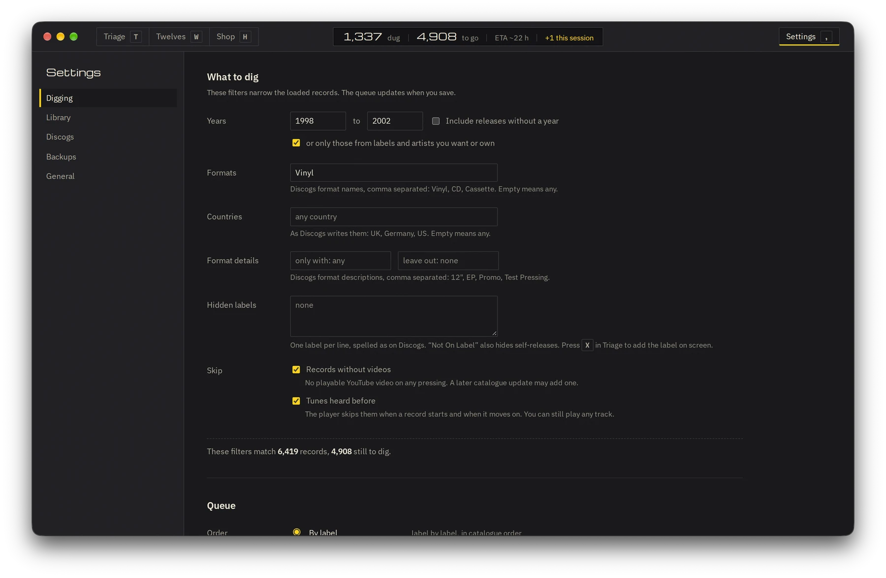
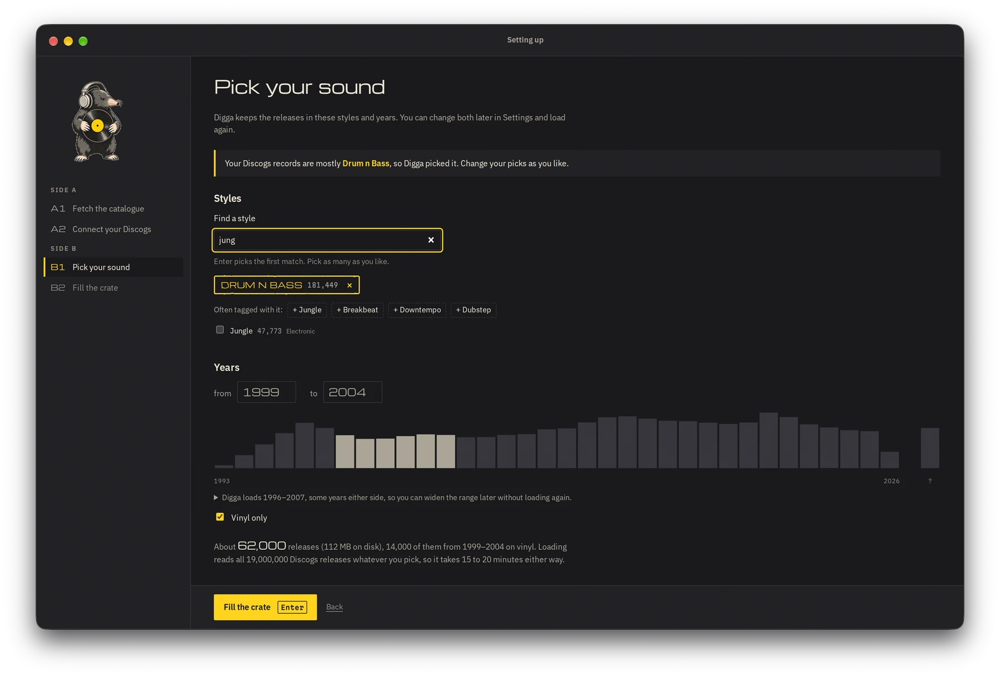
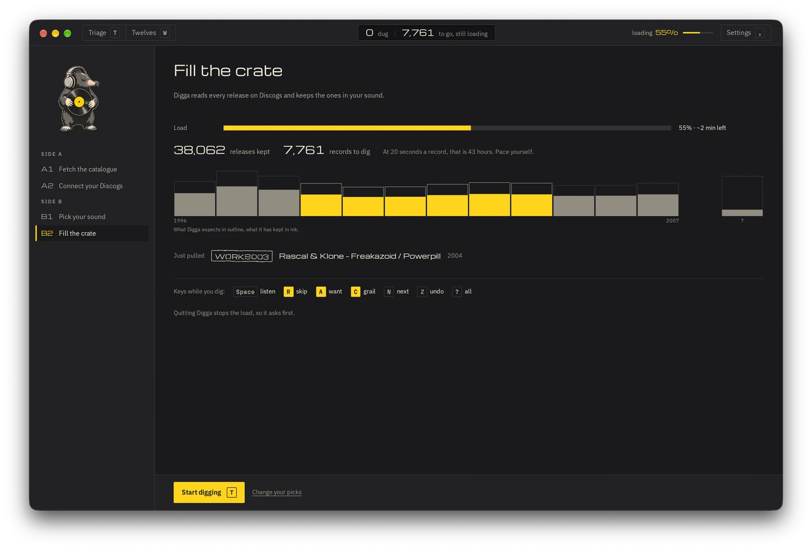

<p align="center">
  <picture>
    <source media="(prefers-color-scheme: dark)" srcset="docs/assets/digga-mole-dark.png">
    <source media="(prefers-color-scheme: light)" srcset="docs/assets/digga-mole-light.png">
    
  </picture>
</p>

# Digga

**Dig Discogs by ear.**

Digga is an app for listening your way through Discogs. Pick the styles and years you like, and
Digga loads every matching release from the Discogs catalogue. Then you hear a few seconds of each
track and decide with one key. Digga remembers what you have heard, what you want and what is
still left.

Use it to build a DJ wantlist, work through a label's back catalogue, or find that tune from an old
radio set you never knew the name of. Out of the box it digs late-1990s and early-2000s drum &
bass, but the styles, years and formats are yours to change.

**Digga is the app. Your twelves are what it finds.**

## Listen, decide, move on

Triage shows the release, its tracklist and a YouTube player on one screen. Each track starts
partway in, wherever you like, and Digga loads the next track and the next record while you
listen. Want it, skip it, call it a grail, or save it for later. Undo steps back through your
session.


| Key       | Action                                                |
| --------- | ----------------------------------------------------- |
| `Space`   | Play or pause                                         |
| `J` / `K` | Next or previous track                                |
| `←` / `→` | Jump back or forward                                  |
| `A`       | Want                                                  |
| `R`       | Skip                                                  |
| `C`       | Grail: the tune you have been hunting, or a top want  |
| `L`       | Snooze: hear it again later                           |
| `N`       | Next: decide later, and the record stays in the queue |
| `X`       | Hide the record's label                               |
| `E`       | Write a note on the record                            |
| `Z`       | Undo                                                  |
| `?`       | Show the keys for the page                            |

You can also mark single tracks, jump to 10% to 90% of a video with the number keys, and open the
release on Discogs. A record plays the videos of all its pressings. When nothing plays, `S`
searches YouTube: copy a video's link and press `⌘V` (`Ctrl+V` on Linux) in Digga to attach it to
the release and play it. The [full keymap](docs/KEYMAP.md) lists every key.

## Keep your finds in Twelves

Twelves collects your wants, grails, maybes and snoozed records, plus the wantlist and collection
you imported from Discogs. Filter and sort the shelves, add notes, change a verdict, or come back
to snoozed records for another listen. The Tracks shelf lists every track you marked grail or
keep, each with its own note.



Once your Discogs account is connected, `A` and `C` also add the record to your Discogs wantlist,
with your note and the tracks you marked as the want's note. Digga still remembers which wants are
grails, and undo takes the record off the wantlist again. If you keep a Maybe list on Discogs,
choose it in Settings to turn on `M`. Digga keeps your maybes itself; adding them to the Discogs
list is up to you.

## Choose what to dig

Settings decides what reaches your queue: styles, years, formats and countries, and whether to
skip records without videos. Format details such as `Unofficial Release` or `Compilation` can keep
records out, and so can hidden labels: `X` in Triage hides the label on screen, and `Z` brings it
back. Dig label by label in catalogue order, by country or by year, or in a shuffled order that
changes each day. You can also choose where in each track playback starts and how far the arrow
keys jump.



Import your collection and wantlist to keep records you already know out of the queue. The counter
in the toolbar shows how many records you have judged and how many are left, and once you have a
pace, about how long the rest will take.

## What stays on your computer

Digga runs on your computer, in its own window on macOS and Linux, or in a browser. The catalogue
and everything you decide live in a SQLite database there. Playback comes from YouTube, and
imports, fresh release details and wantlist changes come from Discogs, so those need an internet
connection.

Every verdict, note, track mark and listen is saved as you make it. `Z` undoes the last verdict
and takes a want back off your Discogs wantlist, and Twelves lets you judge any record again.
Wantlist changes need a Discogs token, but your catalogue and verdicts stay on your computer.

## Run Digga

You can download Digga from [GitHub releases](https://github.com/razorjack/digga/releases): a
`.dmg` for Macs with Apple silicon and an `.AppImage` for x64 Linux, each with a SHA-256 checksum.
These packages do not need Node.js. On macOS, follow
[the installation steps below](#install-a-downloaded-app-on-macos). On Linux, make the AppImage
executable (`chmod +x Digga-<version>-linux-x64.AppImage`) and run it. It needs FUSE 2, as
described below.

To build Digga or run it from source, follow the steps below. Maintainers publish a release by
[pushing a version tag](docs/ELECTRON_PLAN.md#github-releases).

You need **Node.js 24.11 or later on the 24.x line** and npm. Vite+ comes with the project, so you
do not need to install `vp` globally.

### 1. Install and start

```sh
git clone https://github.com/razorjack/digga.git
cd digga
npm install
npm run build
npm run serve
```

Leave the server running and open **[http://localhost:3456](http://localhost:3456)**. Use
`localhost`, not `127.0.0.1`: some YouTube videos refuse to play on a page opened at an IP address.
Next time, `npm run serve` is enough. After you update the frontend, run `npm run build` again.

On macOS and Linux, Digga can also run in its own window, on the same library:

```sh
npm run electron:dev
```

This builds the frontend, starts the server on a free port and opens the window. Quitting the app
stops the server. Only one Digga can use a library at a time, so stop `npm run serve` first. A
terminal inside another Electron app may set `ELECTRON_RUN_AS_NODE=1`, which keeps Electron from
opening a window; unset it there.

To build the app for Macs with Apple silicon, or for x64 Linux:

```sh
npm run electron:package
```

This builds the app for the system you run it on, and the app opens the same library as
`npm run serve`. On a Mac you get `release/Digga-0.0.0-arm64.dmg`, with the app itself in
`release/mac-arm64/Digga.app`, ad-hoc signed and not notarized. On Linux you get
`release/Digga-0.0.0.AppImage`, which runs without installing:

```sh
./release/Digga-0.0.0.AppImage
```

The AppImage needs FUSE 2: `fuse-libs` on Fedora, `libfuse2` on Debian and Ubuntu (`libfuse2t64`
on Ubuntu 24.04). To see it in your desktop's menu, integrate it with a tool such as Gear Lever or
AppImageLauncher. The app encrypts your Discogs token with the desktop's keyring (KWallet on KDE
Plasma). Without a keyring, Settings says that it stores the token unencrypted.

#### Install a downloaded app on macOS

> **Draft, to be confirmed with the first release.** These steps are for macOS 15 and later, and
> nobody has tried them with a downloaded copy of this build yet.

Apple has not notarized Digga, so macOS will not open a downloaded copy until you allow it:

1. Open the dmg and drag Digga to Applications.
2. Open Digga. macOS says it could not verify that Digga is free of malware; choose **Done**.
3. Open **System Settings > Privacy & Security**. Under Security, next to the message that Digga
   was blocked, choose **Open Anyway**, then confirm with **Open Anyway** and your password.

Instead of steps 2 and 3, you can remove the download mark in Terminal:

```sh
xattr -dr com.apple.quarantine /Applications/Digga.app
```

The first time the app reads or saves your Discogs token, macOS asks whether Digga may use the
"Digga Safe Storage" item in your Keychain; choose **Always Allow**. Each new build asks again. If
you choose **Deny**, Digga cannot read the saved token, and Settings asks you for it again.

### 2. Follow the setup

A new library starts with the setup. It takes about 20 minutes, mostly waiting:

1. **Fetch the catalogue.** Discogs publishes its whole catalogue as one file each month, at
   [Discogs data dumps](https://data.discogs.com/). Digga downloads the newest one,
   `discogs_YYYYMMDD_releases.xml.gz` (about 10.5 GB), and checks it against the checksum Discogs
   publishes. Before anything downloads, the first screen shows the file's size and how much free
   space you have.
2. **Connect your Discogs** (optional). Paste a personal access token from
   [Discogs Settings → Developers](https://www.discogs.com/settings/developers); Digga gets your
   username from it. Digga then imports your collection and wantlist, so records you own or want
   stay out of the queue. Without a token, Digga can read a public collection and wantlist by
   username.
3. **Pick your sound.** Choose from every Discogs style, each with its number of releases, and set
   the years over a histogram of their releases. Digga picks the styles your Discogs records mostly
   have, and estimates how many releases your picks add up to.
4. **Fill the crate.** Digga loads the catalogue while it downloads, keeping the releases in your
   styles and years. That takes 15 to 20 minutes, but records arrive within seconds: **Start
   digging** turns on once 500 are waiting, and the toolbar shows the load while you dig.





There is no practice round: Digga saves your verdicts from the first one.

### Where Digga keeps things

Digga keeps its library in your user folder: `~/Library/Application Support/Digga` on macOS,
`%APPDATA%\Digga` on Windows and `~/.config/Digga` on Linux. The library holds the database, its
daily backups, your settings in `digga.config.json` and the Discogs token you save in Settings.
Catalogue files go in the cache folder, which backups skip: `~/Library/Caches/Digga/dumps`,
`%LOCALAPPDATA%\Digga\Cache\dumps` or `~/.cache/Digga/dumps`. Discogs calls these files data
dumps, and so do Digga's commands. `npm run serve` prints both folders.

To keep the library somewhere else, set `DIGGA_DATA_DIR`, plus `DIGGA_DUMPS_DIR` or
`DIGGA_CONFIG_FILE` if you need them, in the environment or in a `.env` file in the folder you run
Digga from. [`.env.example`](.env.example) lists them. A library moved with `DIGGA_DATA_DIR` keeps
its catalogue files inside it unless `DIGGA_DUMPS_DIR` says otherwise. `DIGGA_DUMPS_DIR` also puts
the catalogue files on another disk when the cache folder's disk is short of space. In that case
the desktop app's setup offers to choose another folder; Digga remembers the choice in
`dumps-folder.json` in the library, and `DIGGA_DUMPS_DIR` overrides it.

### Digga and the Discogs API

Digga reads the catalogue from the downloaded file, not through your account. It uses your token
only when you do something, one request at a time:

- your account: when you connect, and each time you open Settings, which shows whose token is
  saved and lists your Discogs lists so you can pick a Maybe list (about two requests a visit);
- your collection and wantlist: one request per 100 records, when you import them;
- your Maybe list: when you import it, or press `I` in Twelves;
- a want: one request 1.5 s after `A` or `C`, one more when `Z` takes it back, and one in Twelves
  when a new verdict puts a record on the wantlist or takes it off;
- a price: one request when you press `P`, for the record on screen;
- a seller's shop: one request per 100 listings, when you read the shop.

Digga waits 1.1 s between requests, which keeps it under Discogs' limit of 60 a minute. It pauses
when Discogs says the limit is nearly used up, and when Discogs says there were too many requests,
it waits as long as Discogs asks. Nothing runs in the background. Digga never changes your
collection or your Discogs lists, and never reads your orders or messages.

A Discogs token cannot be limited to certain actions, so Digga keeps it only on your computer, in
`secrets.env` in the library folder (or reads `DISCOGS_TOKEN` from the environment), and sends it
only to api.discogs.com. The desktop app encrypts the token with the system's keychain when there
is one. Otherwise, and in the browser version, Digga stores it as plain text, and Settings says so.
The command line cannot read a token that the app encrypted, so command-line imports then need
`DISCOGS_TOKEN`. You can revoke the token on discogs.com at any time.

### Settings and the config file

Settings can change everything the setup chose, and saves it in `digga.config.json`:

- `universe.styles` lists the styles to load, by their exact Discogs names, such as `Drum n Bass`.
- `universe.loadYears` limits which years are loaded. The setup loads three extra years on each
  side of the years you dig; `null` loads every year of the chosen styles. The first year cannot
  come after the second, here and in `filters.yearFrom` and `filters.yearTo`.
- `universe.coverage` also loads releases in other styles from the labels and artists of records
  you want or own, when those labels and artists mostly release your chosen styles.
- `filters` narrows what you listen to from the loaded catalogue. You can change these in Settings
  without loading the catalogue again.
- `discogs.username` is the account Digga imports your collection and wantlist from.

Queue filters change right away; adding styles or years means loading the catalogue again.
Discogs publishes a new catalogue file at the start of each month. **Update the catalogue**, on
the Library tab in Settings, downloads and loads it: it adds the records Discogs has added since,
and `F` in Triage digs just those. The Library tab also lists the catalogue files in the folder,
says which one your library came from, and deletes the ones you no longer need (about 10 GB
each).

The catalogue file has no prices or have/want counts. When a record looks worth buying, press `P`
in Triage and Digga asks Discogs for them. The same request fetches the release's current videos,
so a track whose video was added to Discogs after the file was made becomes playable.

### From the command line

Every setup step also runs from the command line:

```sh
npm run digga -- dump update      # download the newest catalogue file unless it is there, then load it
npm run digga -- dump download    # download the newest catalogue file and check it against its checksum
npm run digga -- dump load ~/Library/Caches/Digga/dumps/discogs_YYYYMMDD_releases.xml.gz
npm run digga -- import collection
npm run digga -- import wantlist
```

To try the setup without downloading from Discogs, serve a catalogue file you already have with
`node tools/dev/fake-services.ts <dump.xml.gz>`. It also fakes the Discogs API (token
`e2e-token-dj`) and YouTube's oEmbed. Start Digga with the three addresses it prints
(`DIGGA_DUMPS_URL`, `DIGGA_DISCOGS_API_URL`, `DIGGA_YOUTUBE_OEMBED_URL`) and a throwaway
`DIGGA_DATA_DIR` and `DIGGA_DUMPS_DIR`.

## Useful commands

| Command                              | What it does                                                                           |
| ------------------------------------ | -------------------------------------------------------------------------------------- |
| `npm run digga -- stats`             | Show the catalogue's size, your verdicts, the records left and how long they will take |
| `npm run digga -- import list`       | Import the Maybe list chosen in Settings                                               |
| `npm run digga -- backup`            | Write both backups now (see below)                                                     |
| `npm run digga -- restore <file>`    | Restore a backup (see below)                                                           |
| `npm run digga -- serve --port 3457` | Use another port                                                                       |
| `npm run digga -- help`              | List every command and option                                                          |

## Your decisions and their backups

Discogs only hears about your wants and grails, through your wantlist. Every skip, maybe, snooze,
note, track mark and tune you have heard exists only in Digga's database on your computer, so Digga
backs them up every day. Both kinds of backup go to the `backups` folder in the library folder:

| System  | Backups folder                                                          |
| ------- | ----------------------------------------------------------------------- |
| macOS   | `~/Library/Application Support/Digga/backups`                           |
| Windows | `%APPDATA%\Digga\backups`                                               |
| Linux   | `~/.config/Digga/backups`, or `$XDG_CONFIG_HOME/Digga/backups` when set |

With `DIGGA_DATA_DIR` set, it is `backups` in that folder. The **Backups** tab in Settings shows
the path.

- **`decisions-YYYY-MM-DD.json.gz`: your decisions.** Every verdict, your notes and track marks,
  the tunes you have heard and every listen, the YouTube links you attached, the videos of records
  you marked "no audio", the history of every decision, your recent digging sessions and your
  settings. Your imported wantlist, collection and Maybe list are in it too. Release details are
  not: Digga finds them again by their Discogs ids. Digga keeps the last 30. A day with no changes
  adds no file, so they cover your last 30 days of digging, and a library with no decisions yet
  writes none. A library with 40,000 decisions, 120,000 logged changes to them and 300,000 listens
  writes about 17 MB.
- **`digga-YYYY-MM-DD.sqlite`: the whole database.** Digga keeps the last two. One command
  restores everything from it, but it is 100 MB or more.

The server writes both when it starts, and again each day while it runs.
`npm run digga -- backup` writes both right away.

`gunzip -c decisions-2026-09-30.json.gz` shows what a decisions backup holds: a header line, then
one record per line, each naming its kind in `record`. Here, Stakka & Skynet's _Clockwork_ is a
want, and _Crime Audio_ by Item A La Playa is a grail, marked on its track (lines shortened):

```json
{"app":"digga","kind":"decisions","version":3,"backedUpAt":"2026-09-30T21:04:12.518Z","dataHash":"9c41…","config":{…}}
{"record":"verdict","key":"m:34620","status":"accepted","source":"triage","releaseId":8667,"decidedAt":"2026-09-30T20:41:07.332Z","updatedAt":"2026-09-30T20:41:07.332Z"}
{"record":"verdict","key":"r:620767","status":"candidate","source":"triage","releaseId":620767,"decidedAt":"2026-09-30T20:52:39.905Z","updatedAt":"2026-09-30T20:52:39.905Z"}
{"record":"trackMark","releaseId":620767,"position":"A","mark":"candidate","notes":null,"decidedAt":"2026-09-30T20:52:31.118Z","heardKey":"item a la playa - crime audio",…}
{"record":"heardTune","heardKey":"stakka and skynet - clockwork","firstReleaseId":8667,"secondsListened":14.2,…}
{"record":"listen","eventId":"3f0c…","releaseId":8667,"position":"A","videoId":"…","seconds":14.2,…}
```

- `key` is the record: `m:` and a Discogs master id, like
  [discogs.com/master/34620](https://www.discogs.com/master/34620), or `r:` and a release id for a
  release without a master, like
  [discogs.com/release/620767](https://www.discogs.com/release/620767).
- `status` is the verdict: `accepted` (want), `candidate` (grail), `rejected` (skip), `maybe`,
  `snoozed` or `no_audio`, or `seen` from the browser history import of earlier versions. A record
  you skipped looks the same, with `"status":"rejected"`. What your Discogs collection, wantlist
  and Maybe list hold is in `memberships`, separate from your decisions.
- `source` is `triage` for a decision you made in Digga, or `seed:history` for a page that the
  history import of earlier versions found.
- `releaseId` is the pressing you heard. Times are in UTC.

**To restore**, stop the server first. For a database copy, run
`npm run digga -- restore digga-YYYY-MM-DD.sqlite` with a path or the name of a file in the
backups folder, and you are done. Digga keeps the database it replaces in the backups folder as
`before-restore-YYYY-MM-DD-HHMMSS.sqlite`, and upgrades a copy from an older Digga. The
`before-migration-<version>.sqlite` copy that Digga writes before a schema upgrade restores the
same way. Without a database copy:

1. Load the catalogue again: `npm run digga -- dump update`, or **Update the catalogue** in
   Settings.
2. Run `npm run digga -- restore decisions-YYYY-MM-DD.json.gz` with a path or the name of a file
   in the backups folder. Digga copies the database first, then merges the file in: for each
   verdict and track mark, whichever side changed it last wins, so anything you changed or deleted
   after the backup was written stays as it is. To go back to an earlier state, restore a database
   copy instead.
3. Import your collection and wantlist again, so changes on Discogs since the backup apply.

Both backups are on the same disk as the library. To survive a lost disk, copy the decisions files
somewhere else, such as a cloud drive. Settings can also export your verdicts and track marks as
JSON or CSV, with artist, title and label, to read outside Digga.

## Development

Run the API server and the frontend dev server in separate terminals:

```sh
npm run serve
```

```sh
npm run dev
```

Open [http://localhost:5173](http://localhost:5173). The dev server passes API requests on to the
server on port 3456. Both use your library; to develop against another one, set `DIGGA_DATA_DIR`
in `.env`.

```sh
npm run verify
```

This runs formatting, lint, type checks, unit tests, the portability checks, Svelte checks and the
end-to-end smoke tests, which need Playwright's Chromium (`npx playwright install chromium`). The
frontend uses Svelte 5; the server uses Hono and SQLite. Node runs the server's TypeScript sources
directly.

Digga runs as a local server with a browser app, and in an Electron window, either from the
repository (`npm run electron:dev`, `electron/`) or packaged as an ad-hoc signed macOS app or a
Linux AppImage (`npm run electron:package`).

- [Architecture](docs/ARCHITECTURE.md) and [data model](docs/DATA_MODEL.md)
- [Discogs and YouTube integration notes](docs/DISCOGS_NOTES.md)
- [Design brief](docs/DESIGN_BRIEF.md) and [decisions](docs/DECISIONS.md)
- [Roadmap](docs/ROADMAP.md) and [Electron plan](docs/ELECTRON_PLAN.md)
- [Contributor guide](CLAUDE.md)

## License

MIT; see [LICENSE](LICENSE).
